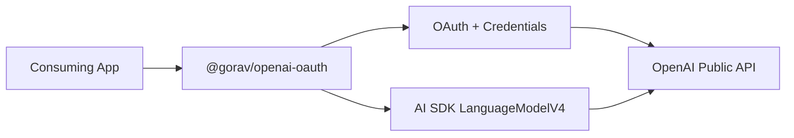

# Architecture

## Overview

`@gorav/openai-oauth` is a Node.js-first Vercel AI SDK provider that authenticates users with OpenAI/ChatGPT OAuth and calls the public OpenAI Responses API directly.

It does not depend on the Codex CLI process or ChatGPT private backend routes.



## Main Components

### Provider

Exposes the AI SDK provider API and creates `LanguageModelV4` instances.

Responsibilities:

- provider configuration
- model selection
- AI SDK integration
- warnings and errors

### Authentication

Handles the documented OpenAI OAuth flow.

Responsibilities:

- PKCE authorization
- callback handling
- token validation
- refresh and revocation
- issued client ID and host identity

The consuming application owns its app name and stable host identity.

### Credential Storage

Use a small abstraction:

```ts
interface CredentialStore {
  load(key: string): Promise<OAuthCredentials | null>;
  save(key: string, credentials: OAuthCredentials): Promise<void>;
  delete(key: string): Promise<void>;
}
```

v0.1 includes a Node `FileCredentialStore`.

The consuming application owns the storage path. Custom stores can be provided later.

### Model Discovery

Models are discovered dynamically using the authenticated account.

Do not maintain a hard-coded model list.

### Responses Client

Calls the public OpenAI API using the OAuth access token.

Main routes:

```text
GET  /v1/models
POST /v1/responses
```

Inference requests for this OAuth flow must use:

```text
store: false
stream: true
```

Do not use private `chatgpt.com/backend-api` routes.

### AI SDK Adapter

The provider maps between AI SDK `LanguageModelV4` and the OpenAI Responses protocol.

`doStream()` converts SSE events into AI SDK stream parts.

`doGenerate()` also sends a streaming request, but aggregates the complete stream into a `LanguageModelV4GenerateResult`.

### Prompt Conversion

The provider converts AI SDK prompts into supported Responses input.

Important constraints:

- send complete required conversation history
- use `instructions` or developer messages for system-level instructions
- omit unsupported request fields
- return AI SDK warnings when generic options cannot be forwarded

## Package Boundary

Everything ships in one package:

```text
@gorav/openai-oauth
```

Keep internal concerns separated, but do not split them into multiple npm packages initially.

Likely modules:

```text
src/
  auth/
  credentials/
  models/
  responses/
  provider/
```

Exact file structure can evolve during implementation.

## Dependencies

Use:

- `@ai-sdk/provider`
- `@ai-sdk/provider-utils`

Do not depend on `@ai-sdk/openai` initially.

The package should implement only the Responses behavior required by this OAuth flow.

## Key Constraints

- Node.js first
- TypeScript + pnpm
- OAuth-backed ChatGPT plan access
- public OpenAI API only
- mandatory streaming inference
- dynamic account-aware model discovery
- no Codex CLI dependency
- no private Codex backend dependency
- minimal dependencies
- protocol behavior must be verified before adding capabilities

## Version Direction

v0.1 provides:

- OAuth
- credential storage
- model discovery
- text generation
- `generateText()`
- basic error handling

v0.2 adds incremental SSE parsing and `streamText()` support. The same
mandatory streaming request is used for both generation paths; cancellation and
non-success stream terminals do not report a successful finish.

v0.3 adds a capability-aware model catalog, safe OAuth-specific provider
metadata, centralized unsupported-option handling, and redacted actionable
errors. The only reasoning request representation currently enabled is the
account-backed validated `reasoning: { effort: "medium" }` control for
`gpt-5.6-terra`; no provider-wide default or inference is made from it.

Model catalog entries retain list-visible server order and display names. They
separate route-wide availability from model/account evidence: validated,
advertised, or unknown. A listed model remains subject to entitlement checks at
request time.

v0.4 adds client-executed function tools. The adapter maps only the validated
top-level Responses function-tool representation; it retains each Responses
`call_id` for AI SDK calls and converts subsequent calls/results into complete
`function_call` and `function_call_output` input items. Provider-hosted tools,
parallel calls, and unvalidated tool encodings remain unavailable.

v0.5 maps `Output.object()` through Responses `text.format` JSON Schema and
maps only user PNG and `text/plain` file parts with fixture-proven URL/data
forms. These mappings are gated to `gpt-5.6-terra`; provider references and
unvalidated media types remain explicit local errors.

v0.6 adds an independent consumer fixture outside source and tests. The release
check builds and inspects the packed tarball, installs it into that fixture, then
type-checks and executes public root imports against offline Responses fixtures.
`OpenAIOAuthError` exposes redacted status/code/parameter/request-ID and retry
guidance directly for consumer error handling.

v1.0 stabilizes this existing public root-entrypoint contract. It does not
broaden the protocol surface, alter the per-instance refresh constraint, or add
new authentication/storage capabilities.

## Refresh concurrency

`OpenAIOAuth` deduplicates refreshes only within one instance. `FileCredentialStore`
serializes file writes across processes, but cannot make the load → token refresh
→ save sequence atomic. Because refresh tokens rotate, applications must not use
the same credential record from multiple processes. Use a separate credential
record per process or a custom store/coordinator that locks the entire refresh
transaction.

Streaming APIs, richer inputs, and other capabilities are added incrementally in later versions.
