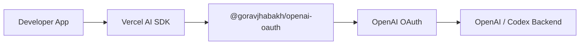

# Project

Release status: the package is prepared for the stable `1.0.0` release. Its
stable contract is intentionally limited to the documented, account-backed
validated OAuth Responses surface; OpenAI's underlying plan-sharing service
remains preview-only.

## Goal

Build `@goravjhabakh/openai-oauth`, a Vercel AI SDK provider that allows users to authenticate with their OpenAI/ChatGPT account instead of requiring a separately billed OpenAI API key.

The provider should feel like a normal AI SDK provider, similar in usage to `@ai-sdk/openai`.

## Motivation

ChatGPT subscriptions and OpenAI API billing are separate.

For developers building personal projects or learning applications, this can mean paying for another API or relying on limited free providers.

This project explores whether the OAuth-backed access used by OpenAI tools such as Codex can be exposed through a normal AI SDK provider.

## Target Experience

```ts
import { generateText } from "ai";
import { openaiOAuth } from "@goravjhabakh/openai-oauth";

const { text } = await generateText({
  model: openaiOAuth("supported-model"),
  prompt: "Hello",
});
```

## High-Level Flow



## Principles

- normal AI SDK provider experience
- OAuth-based authentication
- no required Codex CLI process
- incremental development
- minimal dependencies
- Node.js first
- TypeScript + pnpm
- verify protocol behavior instead of guessing
- use only OpenAI's documented public OAuth and API routes

## Initial Non-Goals

- full parity with `@ai-sdk/openai`
- browser support
- every OpenAI capability
- building a separate AI SDK abstraction
